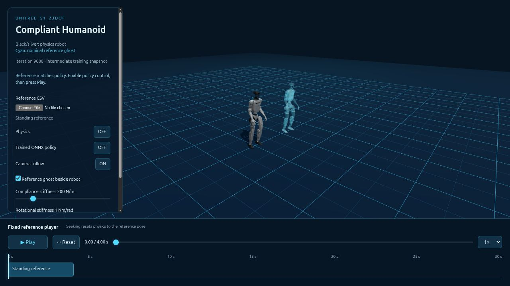

# Compliant Humanoid Motion for Unitree G1 23DOF

A reimplementation of SoftMimic in mjlab and a browser physics demo.

## Installation and environment

Use the `unitree_rl_mjlab` conda environment with Python 3.11, following the original [installation guide](doc/setup_en.md). The repository pins mjlab 1.2.0 and MuJoCo 3.8.1. Skip environment creation if it already exists.

```bash
conda create -n unitree_rl_mjlab python=3.11
```

```bash
conda activate unitree_rl_mjlab
```

```bash
git clone https://github.com/mht3/softmimic_mjlab.git
```

```bash
cd softmimic_mjlab
```

```bash
bash setup.sh
```

```bash
python -m pip install onnx
```

Run the commands below from the repository root. In each new terminal, activate the environment first:

```bash
conda activate unitree_rl_mjlab
```

## Run the included policy demo

```bash
python demos/sonic_web/prepare.py --reference datasets/streamer/stand.csv \
  --deploy demos/policies/stand_9000/params/deploy.yaml \
  --policy demos/policies/stand_9000/exported/policy.onnx
```

```bash
python demos/sonic_web/serve.py --port 8088
```

Open **[Compliant Humanoid](http://127.0.0.1:8088)** in a modern desktop browser. The preparation command rebuilds viewer assets from the included ONNX, source meshes and standing CSV. Enable **Trained ONNX policy**, then press **Play**. Drag the robot to apply forces; reset or scrub the fixed reference below. The cyan ghost shows the nominal pose.

The included model is the **iteration-9000 intermediate checkpoint**, not the final 20k policy. Its PyTorch/ONNX and browser/C++ interface checks pass; these do not certify balance, compliance performance or hardware safety. See the [model record](demos/policies/stand_9000/README.md).



## Create a reference → train → deploy

Only the small `datasets/streamer/stand.csv` input is versioned. Generated IK CSV/NPZ pairs, prepared references, audits, staging/backup directories and legacy motion libraries are local and ignored. Recreate the supported dataset with step 2; its complete audit runs before installation. Generated viewer assets are also ignored and rebuilt by the quickstart above. The published iteration-9000 ONNX and matching deployment configuration remain included.

1. Follow [training setup](doc/setup_en.md) and activate `unitree_rl_mjlab`. For text generation, also follow [ARDY setup](demos/ardy_web/SETUP.md), then run:
   ```bash
   bash demos/ardy_web/run.sh
   ```
   Open [the motion streamer](http://127.0.0.1:8089). Generate, arrange, trim and blend motions; **Save CSV** exports the edited 23DOF trajectory. Root/full-body/hand/foot goals and circle, mouse-waypoint and skill-blending plans are available under **Generation plan**. For the supported standing task, use **+ Standing still reference** and save `datasets/streamer/stand.csv`.
2. Generate and audit all 85 compliant standing trajectories on CPU:
   ```bash
   CUDA_VISIBLE_DEVICES='' OMP_NUM_THREADS=2 MKL_NUM_THREADS=2 OPENBLAS_NUM_THREADS=1 \
     python scripts/generate_standing_from_csv.py \
     --input datasets/streamer/stand.csv --name streamer_stand
   ```
3. Train a fresh 20,000-iteration policy; online W&B project: **g1_compliance**:
   ```bash
   python scripts/check_compliant_dataset_ready.py src/assets/compliant_motions/g1_23dof/streamer_stand
   ```

   ```bash
   bash train_configs/compliance/streamer_stand.sh
   ```
4. Follow [export and simulation](WORKFLOW.md#4-package-and-visualize-the-trained-policy) to package the matching ONNX, deployment YAML and reference, then install them into the browser demo. Moving reference files require a motion-specific tracker; the current training/deployment path supports constant standing.
5. After simulation evaluation, follow [real-robot deployment](deploy/README.md) and the [matched bundle instructions](WORKFLOW.md#5-prepare-real-robot-deployment) for the 23DOF C++ controller:
   ```bash
   ./deploy/robots/g1_23dof/build/g1_ctrl --network=YOUR_ROBOT_NETWORK_INTERFACE
   ```

[Full reproducible workflow](WORKFLOW.md) · [Motion editor controls](demos/ardy_web/README.md) · [Policy player](demos/sonic_web/README.md)

For a remote workstation, run this on your local machine:

```bash
ssh -N -L 8088:127.0.0.1:8088 -L 8089:127.0.0.1:8089 USER@WORKSTATION
```

## Credits

Thanks to the following papers which helped make this repo:

- [SoftMimic](https://github.com/Improbable-AI/softmimic): compliant augmentation and policy learning.
- [ARDY](https://github.com/nv-tlabs/ardy): pretrained text/constraint-conditioned motion generation. [Paper and examples](https://research.nvidia.com/labs/sil/projects/ardy/).
- [unitree_rl_mjlab](https://github.com/unitreerobotics/unitree_rl_mjlab): training and robot deployment foundation.
- [GEAR-SONIC](https://nvlabs.github.io/GEAR-SONIC/): original Three.js/MuJoCo-WASM [demo source](https://nvlabs.github.io/GEAR-SONIC/demo.html), adapted for both viewers. [Source provenance](demos/sonic_web/upstream_manifest.json).
- [mjlab](https://github.com/mujocolab/mjlab), [Mink](https://github.com/kevinzakka/mink), and [RSL-RL](https://github.com/leggedrobotics/rsl_rl): simulation, IK and RL infrastructure.
