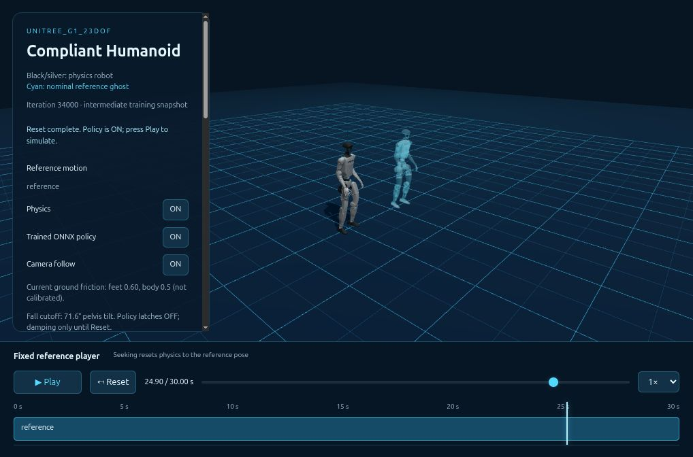

# Compliant Humanoid Motion for Unitree G1 23DOF

A reimplementation of SoftMimic in mjlab and a browser physics demo.

## Installation and environment

Use the `unitree_rl_mjlab` conda environment with Python 3.11, following the original [installation guide](doc/setup_en.md). The repository pins mjlab 1.2.0 and MuJoCo 3.8.1. Skip environment creation if it already exists.

```bash
conda create -n unitree_rl_mjlab python=3.11
```

```bash
conda activate unitree_rl_mjlab
```

```bash
git clone https://github.com/mht3/softmimic_mjlab.git
```

```bash
cd softmimic_mjlab
```

```bash
bash setup.sh
```

```bash
python -m pip install onnx
```

Run the commands below from the repository root. In each new terminal, activate the environment first:

```bash
conda activate unitree_rl_mjlab
```

## Run the included policy demo

```bash
python demos/sonic_web/serve.py --port 8088 \
  --reference deploy/robots/g1_23dof/config/policy/compliant_mimic/stand/params/reference.csv \
  --deploy deploy/robots/g1_23dof/config/policy/compliant_mimic/stand/params/deploy.yaml \
  --policy deploy/robots/g1_23dof/config/policy/compliant_mimic/stand/exported/policy.onnx
```

Open **[Compliant Humanoid](http://127.0.0.1:8088)** in a modern desktop browser. The launch command validates all three files and rebuilds viewer assets from the included ONNX, source meshes and standing CSV. Enable **Trained ONNX policy**, then press **Play**. **Reset** or **R** restores the pose and turns policy/physics ON, with playback paused until Play. Drag the robot to apply forces; reset or scrub the fixed reference below. The cyan ghost shows the nominal pose.

The demo and default hardware configuration use the matched **checkpoint 34,000** from the fresh 50k training run. It passed **16/16** basic standing/recovery trials, **6/6** seeded dynamics trials, and both delay stress trials; noisy wrist RMS was **0.313 rad/s** ([comparison and test limits](doc/ROBUSTNESS_TESTING.md)). The run is ongoing; this is a selected intermediate checkpoint. Run `python deploy/check_bundle.py` to verify the included ONNX, YAML, CSV and portable controller config. Physical robot validation remains required.



## Create a reference → train → deploy

The small `datasets/streamer/stand.csv` input and the matched deployment reference CSV are versioned. Generated IK CSV/NPZ pairs, prepared references, audits, staging/backup directories and legacy motion libraries are local and ignored. Recreate the supported dataset with step 2; its complete audit runs before installation. Generated viewer assets are also ignored and rebuilt by the quickstart above. The demo and deployment ONNX files and matching deployment configurations remain included.

1. Follow [training setup](doc/setup_en.md) and activate `unitree_rl_mjlab`. For text generation, also follow [ARDY setup](demos/ardy_web/SETUP.md), then run:
   ```bash
   bash demos/ardy_web/run.sh
   ```
   Open [the motion streamer](http://127.0.0.1:8089). Generate, arrange, trim and blend motions; **Save CSV** exports the edited 23DOF trajectory. Root/full-body/hand/foot goals and circle, mouse-waypoint and skill-blending plans are available under **Generation plan**. For the supported standing task, use **+ Standing still reference** and save `datasets/streamer/stand.csv`.
2. Generate and audit all 85 compliant standing trajectories on CPU:
   ```bash
   python scripts/generate_standing_from_csv.py \
     --input datasets/streamer/stand.csv --name streamer_stand_smooth \
     --max-joint-velocity 3 --max-wrist-velocity 1.5 --workers 4
   ```
3. Train a fresh 20,000-iteration policy; online W&B project: **g1_compliance**:
   ```bash
   python scripts/check_compliant_dataset_ready.py src/assets/compliant_motions/g1_23dof/streamer_stand_smooth
   ```

   ```bash
   bash train_configs/compliance/stand_stable.sh
   ```
4. Follow [export and simulation](WORKFLOW.md#4-package-and-visualize-the-trained-policy) to package the matching ONNX, deployment YAML and reference, then install them into the browser demo. The standing checkpoint requires a fixed nominal pose. The generic motion task and both runtimes support time-varying nominal channels; see [motion support and stability settings](doc/STABILITY_AND_MOTION.md).
5. After simulation evaluation, follow [real-robot deployment](deploy/README.md) and the [matched bundle instructions](WORKFLOW.md#5-prepare-real-robot-deployment) for the 23DOF C++ controller:
   ```bash
   ./deploy/robots/g1_23dof/build/g1_ctrl --network=YOUR_ROBOT_NETWORK_INTERFACE
   ```

[Full reproducible workflow](WORKFLOW.md) · [Motion editor controls](demos/ardy_web/README.md) · [Policy player](demos/sonic_web/README.md) · [Noise and domain randomization tests](doc/ROBUSTNESS_TESTING.md)

For a remote workstation, run this on your local machine:

```bash
ssh -N -L 8088:127.0.0.1:8088 -L 8089:127.0.0.1:8089 USER@WORKSTATION
```

## Credits

Thanks to the following papers which helped make this repo:

- [SoftMimic](https://github.com/Improbable-AI/softmimic): compliant augmentation and policy learning.
- [ARDY](https://github.com/nv-tlabs/ardy): pretrained text/constraint-conditioned motion generation. [Paper and examples](https://research.nvidia.com/labs/sil/projects/ardy/).
- [unitree_rl_mjlab](https://github.com/unitreerobotics/unitree_rl_mjlab): training and robot deployment foundation.
- [GEAR-SONIC](https://nvlabs.github.io/GEAR-SONIC/): original Three.js/MuJoCo-WASM [demo source](https://nvlabs.github.io/GEAR-SONIC/demo.html), adapted for both viewers. [Source provenance](demos/sonic_web/upstream_manifest.json).
- [mjlab](https://github.com/mujocolab/mjlab), [Mink](https://github.com/kevinzakka/mink), and [RSL-RL](https://github.com/leggedrobotics/rsl_rl): simulation, IK and RL infrastructure.
