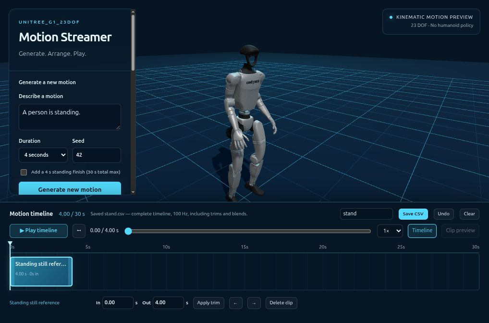

# Compliant Motion for the Unitree G1 23DOF

Create a reference motion, generate compliant targets with inverse kinematics, train in mjlab, and evaluate the matched controller in simulation before deployment.

This repository adapts SoftMimic to mjlab and the G1's 23 active joints. The reproducible example below trains **compliant standing with a fixed nominal reference**. The streamer can also save edited moving motions for future motion-specific training; the standing training/export/deployment path rejects those moving references. Saving a motion does not make it dynamically feasible or produce a trained controller.

## 1. Set up and author a reference

Follow [installation](doc/setup_en.md), then activate the training environment:

```bash
conda activate unitree_rl_mjlab
cd softmimic_mjlab
```

Both browser apps live in this repository under `demos/`. The streamer uses a separate CPU environment and downloaded ARDY weights. On a fresh workspace, follow [streamer setup](demos/ardy_web/SETUP.md).

Generated IK datasets, converted NPZs, prepared references, audits and viewer assets are ignored by Git. The small `datasets/streamer/stand.csv` seed and the published policy/YAML are versioned. Rebuild shared viewer assets with the [README quickstart](README.md#run-the-included-policy-demo) before starting either browser app; regenerate training data with step 2 below. Legacy motion collections remain local-only.

```bash
bash demos/ardy_web/run.sh
```

Open **[Unitree_G1_23dof Motion Streamer](http://127.0.0.1:8089)**. Generate motions from text, drag them into the bottom timeline, trim/reorder, scrub and play. The edit is limited to 30 seconds. Amber warning icons on segments show retargeting-fit errors on hover. **Save CSV** exports the actual edited trajectory, including trims, world-position alignment and transition blends, at 100 Hz. It does not rerun the prompts.

For this standing example, clear the timeline, choose **+ Standing still reference**, name it `stand`, then **Save CSV**. Save the downloaded file as `datasets/streamer/stand.csv`. A matching example is included in the repository.



For motion authoring, **Generation plan** also supports prompt blending and timed root, full-body, hand and foot goals. Example plans include side stepping → jogging → jumping, circular walking and mouse-placed waypoints. See the [streamer controls and ARDY source references](demos/ardy_web/README.md#ardy-generation-plan-and-spatial-goals). These generate motion references; they do not change the standing controller's capabilities.

CSV format: comment metadata with named joints and frame rate, followed by `XYZ root position, XYZW root quaternion, 23 joint positions` (30 columns). Units are metres/radians. The source-clip CSV links use a different upstream format; **use Save CSV for this pipeline**. Edited transitions are kinematic blends and need their own downstream audit.

For a remote workstation, forward both ports from your laptop:

```bash
ssh -N -L 8089:127.0.0.1:8089 -L 8088:127.0.0.1:8088 USER@WORKSTATION
```

## 2. Generate and audit compliant standing targets

Run in the training conda environment, from the repository root:

```bash
CUDA_VISIBLE_DEVICES='' OMP_NUM_THREADS=2 MKL_NUM_THREADS=2 OPENBLAS_NUM_THREADS=1 \
  python scripts/generate_standing_from_csv.py \
  --input datasets/streamer/stand.csv --name streamer_stand
```

The command validates the saved pose and named joint order, prepares a 30-second nominal reference at 30 Hz, and runs **direct 23DOF constrained IK**. It generates 40 forcefield, 40 collision-emulator and 5 zero-wrench trajectories, converts them to 50 Hz NPZs, and audits all 85 CSV/NPZ pairs. Joint limits, speed, feet, force/displacement consistency, collision samples, release recovery, array structure and source hashes must pass. No threshold is relaxed on failure.

Only after success are the reference and dataset installed at:

- `datasets/reference23/streamer_stand.csv` — nominal reference; 32 columns including foot contacts.
- `src/assets/compliant_motions/g1_23dof/streamer_stand/` — compliant targets, `audit.json` and `generation.json`.

Existing datasets are preserved; choose another `--name` for a new version. Failed stages remain under `.streamer-*` for diagnosis. The command never starts training. To recheck the installed audit and hashes:

```bash
python scripts/check_compliant_dataset_ready.py \
  src/assets/compliant_motions/g1_23dof/streamer_stand
```

## 3. Train compliant standing

```bash
bash train_configs/compliance/streamer_stand.sh
```

This script requires **all 85 audited files**, starts a fresh **20,000-iteration** run with 4,096 environments, and logs online to W&B project **`g1_compliance`**. Authenticate W&B in this environment beforehand. Run it when your GPU is available; it does not coordinate with another training process. For another dataset name, set `MOTION_FILE=src/assets/compliant_motions/g1_23dof/YOUR_NAME` before the command.

Runs are written under `logs/rsl_rl/g1_23dof_compliant_tracking/`. Wait for training to finish, then use that run's **matching** `policy.onnx` and `params/deploy.yaml`. Do not substitute an early diagnostic export or mix files from different runs.

## 4. Package and visualize the trained policy

Set `RUN` to the completed run directory. Bundle names must be new; the packager never overwrites a bundle.

```bash
RUN=/absolute/path/to/completed/training/run
BUNDLE="$PWD/deploy/robots/g1_23dof/config/policy/streamer_stand"
python demos/package_standing_policy.py --run "$RUN" --output "$BUNDLE" \
  --reference datasets/reference23/streamer_stand.csv \
  --dataset src/assets/compliant_motions/g1_23dof/streamer_stand

CUDA_VISIBLE_DEVICES='' OMP_NUM_THREADS=2 MKL_NUM_THREADS=2 OPENBLAS_NUM_THREADS=1 \
  python demos/check_cpp_policy_contract.py --bundle "$BUNDLE"
CUDA_VISIBLE_DEVICES='' OMP_NUM_THREADS=2 MKL_NUM_THREADS=2 OPENBLAS_NUM_THREADS=1 \
  python demos/sonic_web/test_policy_contract.py --deploy "$BUNDLE/params/deploy.yaml"
```

If either check fails, stop before installing. These checks validate observation/action interfaces and normalization parity, not learned balance or compliance.

```bash
python demos/sonic_web/prepare.py \
  --reference "$BUNDLE/params/reference.csv" \
  --deploy "$BUNDLE/params/deploy.yaml" \
  --policy "$BUNDLE/exported/policy.onnx" \
  --stiffness 200 --rotational-stiffness 1
python demos/sonic_web/serve.py --port 8088
```

Open **[Compliant Humanoid](http://127.0.0.1:8088)**. A required nominal reference appears in the fixed bottom timeline. The black/silver robot is the physics body; the translucent cyan ghost shows the reference beside it. Play/pause, seek, reset and playback speed remain available. Seeking resets the physical state to the selected reference pose; it does not reconstruct a previous rollout. Toggle the ghost offset to overlay the two robots.


Policy control starts **OFF**. Enable the matched ONNX policy, then press **Play**. Drag the robot to apply forces; drag the floor to orbit and scroll to zoom. Test standing, hand pulls, downward loads and release recovery before robot use. Physics without an enabled controller will let the robot fall. A changing or mismatched reference disables standing-policy control. See [player details](demos/sonic_web/README.md) for simulation differences.

The policy receives nominal-reference channels and robot proprioception. External hand forces influence measured joint/root motion; the deployed actor does not receive an oracle measurement of your hand force. Dataset wrench labels supervise compliant targets during training. The stiffness sliders command learned compliance inputs, not raw motor PD gains.

## 5. Prepare real-robot deployment

The bundle already puts the files in the controller's expected layout:

```text
config/policy/streamer_stand/
  exported/policy.onnx
  params/deploy.yaml
  params/reference.csv       # full nominal reference for the browser/provenance
  params/stand.npz           # constant nominal reference for the C++ controller
  controller_config.yaml    # standing-only FSM with matched paths
  manifest.json
```

Build the **23DOF C++ controller** using the dependencies in [deployment setup](deploy/README.md):

```bash
cmake -S deploy/robots/g1_23dof -B deploy/robots/g1_23dof/build
cmake --build deploy/robots/g1_23dof/build -j2
```

After successful simulation evaluation, back up the active configuration and install the bundle's standing-only configuration. These are manual deployment steps; generating or viewing a motion never starts hardware.

```bash
cp deploy/robots/g1_23dof/config/config.yaml \
   "deploy/robots/g1_23dof/config/config.yaml.backup.$(date +%Y%m%d_%H%M%S)"
cp "$BUNDLE/controller_config.yaml" deploy/robots/g1_23dof/config/config.yaml
./deploy/robots/g1_23dof/build/g1_ctrl --network=YOUR_ROBOT_NETWORK_INTERFACE
```

Use the robot preparation/suspension and debug-mode procedure in the deployment guide. In the generated configuration: **LT + Up** enters FixStand; **RB + A** enters compliant standing; **LT + B** returns to Passive. The generated FixStand target matches the policy's nominal pose. If transferring to another machine, copy the entire bundle and update its absolute paths in `controller_config.yaml`. No hardware validation of a newly trained policy is implied by passing the export tests.

## Sources and attribution

- **[ARDY](https://github.com/nv-tlabs/ardy)** — text-conditioned autoregressive motion generation, pretrained models and motion presets. [Project/paper](https://research.nvidia.com/labs/sil/projects/ardy/).
- **[SoftMimic](https://github.com/Improbable-AI/softmimic)** — compliant motion augmentation and policy-learning method; this repository ports that approach to mjlab and 23DOF.
- **[unitree_rl_mjlab](https://github.com/unitreerobotics/unitree_rl_mjlab)** — foundation for the mjlab training and Unitree deployment code.
- **[GEAR-SONIC](https://nvlabs.github.io/GEAR-SONIC/)** — source of the [published Three.js/MuJoCo-WASM demo](https://nvlabs.github.io/GEAR-SONIC/demo.html), adapted for both local viewers. Original files and URL/SHA256 provenance are retained in [`demos/sonic_web/upstream/`](demos/sonic_web/upstream/) and [`upstream_manifest.json`](demos/sonic_web/upstream_manifest.json).
- **[mjlab](https://github.com/mujocolab/mjlab)**, **[Mink](https://github.com/kevinzakka/mink)** and **[RSL-RL](https://github.com/leggedrobotics/rsl_rl)** supply simulation, constrained IK and RL infrastructure.

Upstream license notices remain with the source and runtime files. These adaptations are not official ARDY, SoftMimic or GEAR-SONIC releases.
