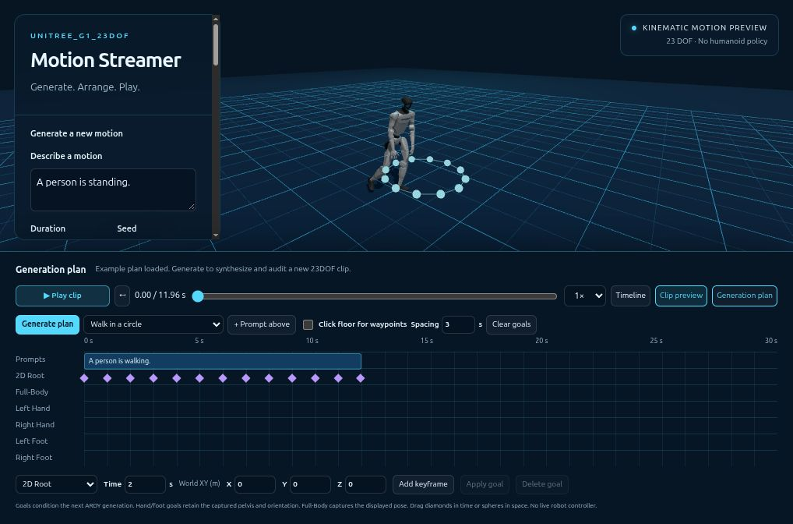

# Unitree_G1_23dof Motion Streamer

Working local text-to-motion preview: **http://127.0.0.1:8089**. The CPU server runs in tmux **`ardy-demo`**. The [SoftMimic policy player](../sonic_web/README.md) at port 8088 is separate. See the [main CSV → IK → training workflow](../../README.md).

Type a motion description or choose one of the **10 verbatim presets from upstream ARDY**, choose 2–30 seconds and a seed, then Generate new motion. Drag saved clips onto the bottom timeline to edit and play them immediately. The timeline does not regenerate their prompts. The library initially contains real standing, walking, bowing, and right-sidestep generations. Playback supports pause, restart, scrubbing, speed, orbit/zoom, and camera following. NPZ, CSV and audit downloads are beside each clip.

This is **kinematic reference playback**, with no humanoid policy, dynamics rollout, force interaction, or hardware connection. The robot has the actual target's 23 named joints. Physics/drag forces belong to the separate standing-policy demo: applying them to a kinematically prescribed motion would misleadingly imply controller behavior.

## Start / reproduce

From the SoftMimic mjlab repository root:

```bash
bash demos/ardy_web/run.sh
```

For a fresh installation, follow [SETUP.md](SETUP.md). The launcher uses the separate `../sonic23/.venv-ardy` environment, disables CUDA, and limits CPU threads. The ARDY source, model cache and generated library remain in sibling workspace directories; both demo implementations are in this repository. The existing server is in tmux `ardy-demo` at port 8089. Do not start a duplicate on the same port.

## Save the edited motion

**Save CSV** writes the whole timeline at 100 Hz, including trims, aligned root motion and transition blends. Enter a filename next to the button. The CSV has JSON comment metadata with joint names and **XYZW** root quaternions, then 30 numeric columns. This differs from original ARDY source downloads. Saving does not overwrite source clips or mark blended transitions collision-audited.

**+ Standing still reference** adds an explicit fixed pose for the supported standing training pipeline. An ARDY text-generated standing animation can move; it is not interchangeable with that fixed reference. The prepared CSV, compliant IK targets and matching policy export are tied together in the main README.

## ARDY generation plan and spatial goals

Open **Generation plan** in the bottom editor. It has a prompt lane and **2D Root, Full-Body, Left Hand, Right Hand, Left Foot, Right Foot** lanes. This plan conditions a new ARDY generation; the saved-motion editing timeline remains independent and retains its clips. Switch back to **Generation plan** to close it, then drag the generated result into the saved edit and **Save CSV**.



- Choose **Side step → jog → jump → stand** for history-conditioned prompt changes, **Walk in a circle** for a 12-second circular root path, or **Mouse waypoints** for an eight-second walking plan. These recreate the published example workflows; they are not NVIDIA's original saved trajectories. Results still depend on generation and retargeting quality.
- Click a prompt block to edit its text or duration. **+ Prompt above** adds the left-panel prompt. The entire plan is limited to 30 seconds.
- Choose a track and time, then **Add keyframe**. Root targets use world XY in metres, with Z up. **Click floor for waypoints** places root goals in the scene and advances the target time by **Spacing**. A camera drag does not place a waypoint.
- Full-Body captures the displayed 23DOF pose. Hand/foot goals capture the displayed pose and add an XYZ offset to that limb. Like upstream ARDY, these named limb constraints also retain the captured pelvis and orientation. They are not unconstrained limb-only IK targets. Capture a relevant pose before adding them.
- Drag a diamond along its lane to change the time, or drag a target sphere in the scene. Root spheres move on the ground plane; limb spheres move in the camera-facing plane. Numeric **Apply goal** supports precise XYZ edits. **Delete goal** removes the selected keyframe. Times snap to ARDY's 25 Hz frames.
- Press **Generate plan**. Submitted goals are fixed for that job; edits affect the next generation. This CPU authoring service does not implement live replanning of a running robot controller. Distant constraints expand ARDY's inference window, so constrained CPU requests can take substantially longer than unconstrained clips.

The adapter maps the 23 named joints into ARDY's native skeleton, preserves the missing joints at zero, converts Z-up coordinates to ARDY's Y-up representation, and uses its native constraint classes, normalization, history masking and bounded future context. The generated 29DOF result then passes through the existing constrained 23DOF retargeter and geometry gate. Goals are model conditioning, not guaranteed exact endpoints. `schedule.json` records prompts and goals; `audit.json` reports realized goal errors separately from collision checks. Source-fit and goal-fit warnings appear on saved timeline blocks and in their hover text. Edited joins still need their own audit.

Tested examples: the 12-second circle passed its geometry audit (maximum root-goal error 3.7 cm), with a palm-fit warning. The skill-blending preset at seed 42 was rejected during the jogging transition because required ground correction was 3.74 cm, above the unchanged 3 cm limit. It remains an editable example, not a validated downloadable full motion.

Implementation references at the pinned upstream revision: [constraint construction](https://github.com/nv-tlabs/ardy/blob/e706e27acc88070918308a10922b8f7174d0825e/scripts/interactive_demo/gen_constraints.py), [waypoint handling](https://github.com/nv-tlabs/ardy/blob/e706e27acc88070918308a10922b8f7174d0825e/scripts/interactive_demo/constraints.py), [generation and history](https://github.com/nv-tlabs/ardy/blob/e706e27acc88070918308a10922b8f7174d0825e/scripts/interactive_demo/generation.py), and [native constraint classes](https://github.com/nv-tlabs/ardy/blob/e706e27acc88070918308a10922b8f7174d0825e/ardy/constraints.py). The [published ARDY examples](https://research.nvidia.com/labs/sil/projects/ardy/) combine generated references with a separate tracking controller; this GUI previews references only.

## Models and resource measurements

- Motion: `nvidia/ARDY-G1-RP-25FPS-Horizon8`, pinned revision `fb815e8021d700af523ac32d9851b7e489fbb60b`, under `sonic23/checkpoints/ARDY-G1-RP-25FPS-Horizon8/`.
- Text: Meta-Llama-3-8B-Instruct plus McGill LLM2Vec MNTP and supervised adapters. Exact revisions, locations and byte counts: `sonic23/ardy_text_models.json`.
- Downloaded text dependencies: **16,416,813,301 bytes (15.29 GiB)**. Motion model files: **774,789,008 bytes (0.72 GiB)**. These sizes exclude the Python environment and existing SONIC checkpoints.
- CPU test: four seconds of standing motion took **28.4 s generation + 5.2 s retarget/audit = 33.6 s**, using an already-cached text embedding. A cold, uncached standing request took **107.8 s** total, including **76.8 s** loading/encoding. Later new prompts reuse the resident encoder. This is not real-time CPU streaming.
- An authorized single RTX 5090 probe used a cached CPU text embedding and put **only the ARDY motion model** on GPU. Four seconds of motion took **3.29 s**. Peak PyTorch tensor allocation: **943,703,040 bytes (900 MiB)**; reserved: **958,398,464 bytes (914 MiB)**. CUDA context/driver memory is additional. This does **not** measure Llama-on-GPU memory. The probe used a 10%-of-GPU allocator ceiling, required 8 GiB free headroom, completed and exited. It did not restart/change SoftMimic. Report: `sonic23/ardy_gpu_probe/gpu_memory_report.json`. The browser service remains CPU-only.

The encoder loader explicitly constructs the bidirectional Llama model, merges the MNTP adapter, then attaches the supervised adapter. This fixes Transformers 5's failure to infer the base model from ARDY's adapter-only path. It preserves the upstream tokenizer, pooling defaults, bfloat16 precision and the Meta-Llama model identity used for instruction formatting. G1 generation uses the required zero initial heading, upstream 10 denoising steps and separated CFG `(2, 2)`. The motion seed is set **after** lazy text-encoder loading/encoding, so model construction cannot change the motion RNG sequence for an uncached prompt.

## Files and retargeting

Every successful clip has its own immutable UUID directory in:

`/home/mht/research/rl/humanoid/compliance/sonic23/ardy_motions/`

- `source_29dof.npz`: untouched ARDY 25 Hz qpos, 36 columns.
- `motion_23dof.npz`: constrained target qpos, **30 columns**, with `fps`, `joint_names`, `quaternion_order='wxyz'`, `up_axis='z'`.
- `motion_23dof.csv`: commented column header, then root XYZ + quaternion **WXYZ** + the 23 named joint angles. **This is not SoftMimic's XYZW augmentation CSV schema.** Do not feed it to that converter unchanged.
- `motion.json`: browser playback with the same values/order as NPZ.
- `audit.json`: geometry/path checks, residual tracking errors, constant ground alignment, fidelity warning and model hashes.
- `metadata.json`: prompt, seed, duration, timing scope, model revisions and implementation hashes. Re-retargeted saved sources retain `source_id`; their timing is explicitly retarget-only.

Retargeting uses source FK, named joint correspondence, palm/foot/pelvis/torso frame targets, and a named posture prior. Missing waist pitch/roll and wrist pitch/yaw are compensated through the remaining joints; the six columns are not merely dropped. The source rigid-root motion is fed forward so an arm collision correction cannot freeze walking's world translation. Independent target and deployment collision geometries both enter the IK constraints using their own FK/Jacobians and verified joint order.

ARDY's 25 Hz source is interpolated for a **100 Hz IK output**, retaining the solved curved motion path rather than collapsing it into straight segments between 25 Hz endpoints. A four-second source has 100 frames / 3.96 seconds between its first and last sample; the retargeted equivalent has 397 frames at 100 Hz. All emitted frames and three samples per transition are independently audited against both collision models. Ground alignment is one constant vertical offset for the whole clip, limited to 3 cm and reported; it never warps individual frames or relaxes the penetration threshold.

The geometry gate requires zero detected self-penetration at tested samples, joint-limit error <= 1e-5 rad, joint speed <= 6.001 rad/s, and ground penetration <= 2 mm. Failed clips are not published in the library; the original source and failure report are retained for diagnosis. Early development exports are archived under `_development/` and not listed.

**Limitations:** collision proxies plus discrete sampling are not continuous collision certificates. The 6 rad/s limit is a preview constraint, not hardware authorization. Balance, contact forces, foot sliding, torques, accelerations and closed-loop tracking are not validated. Geometry success is distinct from motion fidelity. The UI explicitly flags maximum tracking-error bounds above 8 cm feet, 12 cm palms, or 8 cm pelvis. The current bow and walking clips are flagged for review (bow: 8.6 cm foot bound; walking: 9.2 cm feet / 15.7 cm palms / 10.4 cm pelvis). Standing and sidestepping are below these review thresholds. Generated semantics and difficult arbitrary prompts are not guaranteed. No generated file is automatically installed in a training dataset or controller.

## Verification

```bash
../sonic23/.venv-ardy/bin/python -m unittest demos.ardy_web.test_retarget \
  demos.ardy_web.test_streaming demos.ardy_web.test_constraints -v
```

```bash
node --test demos/ardy_web/test_constraint_plan.mjs demos/ardy_web/test_timeline.mjs \
  demos/ardy_web/test_motion_blend.mjs demos/ardy_web/test_csv_export.mjs
```

```bash
../sonic23/.venv-ardy/bin/python demos/ardy_web/validate_library.py
```

Twelve Python tests pass, covering retargeting, streaming and all six native constraint types. The earlier independent library validation passed **four clips / 1,588 frames**, checked interpolated paths, and cross-checked CSV/NPZ/JSON values and order; it does not cover subsequently generated clips. Report: `sonic23/ardy_library_validation.json`. Each new generation has its own audit. Real CPU prompt encoding/generation and browser submission -> export -> playback were exercised, along with file downloads and HTTP request validation. The cold-encoder and cached-embedding standing runs produced **bitwise-identical source and retargeted qpos** for seed 42 (`sonic23/ardy_seed_reproducibility.json`). See [workflow verification](../WORKFLOW_VALIDATION.md) for the constrained root and circle results.

To retry a saved source after an intentional retargeter improvement without rerunning ARDY:

```bash
../sonic23/.venv-ardy/bin/python demos/ardy_web/retarget_saved.py \
  ../sonic23/ardy_motions/SOURCE_UUID
```

This writes a new directory and preserves the original. The old `demos/ardy_source.py` is a separate experimental 29DOF streaming scaffold; it is not this demo's entry point.

## Attribution

Generation and preset text come from [NVIDIA ARDY](https://github.com/nv-tlabs/ardy). The renderer is the existing downloaded [GEAR-SONIC Three.js / MuJoCo-WASM demo](https://nvlabs.github.io/GEAR-SONIC/demo.html), served read-only from `../sonic_web/js/viewer.js`, its runtime libraries and target robot assets. Original source/provenance is preserved in `../sonic_web/upstream/` and `upstream_manifest.json`. Both demos use the maintained shared renderer and native black/silver MJCF materials; neither uses Viser.

## Bottom timeline editor

The bottom track is a **30-second maximum saved-motion edit**, independent of the CPU generator:

- Drag a generated clip from the library onto the track, or click its **+** button. Named blocks have widths proportional to their trimmed durations. Empty space remains visible up to the 30-second ruler mark.
- Press **Play timeline** / **Pause timeline**, or Space outside text fields. Playback starts from the current playhead. Click or drag the ruler, or use the playback slider, to choose a start time. Clicking a block selects it and seeks to its start. At the end, pressing Play restarts from zero.
- Drag a block before/after another block to reorder the contiguous edit. Arrow buttons offer keyboard-accessible movement. This is a single sequential track; gaps and overlapping layers are not implemented.
- Drag either edge of a block to trim it, or set **In** and **Out** source times and click **Apply trim**. Enter and native input changes also apply trims. Edits snap to source frames, retain at least two samples, and never overwrite the original motion file.
- **Delete clip**, Delete, **Clear**, and **Undo** edit the track. Undo / Ctrl-Z restores the last operation (up to 40 edits in the current page session).
- Library-backed edits are saved in browser local storage and restored on reload with their source IDs, order and trim points. The old `ardySequence` prompt list is left intact but is not interpreted as a saved-motion edit, since it did not store source clip IDs.
- **Clip preview** plays one original clip separately; **Timeline** returns to the edit. Dropping an exported `motion.json` onto the track imports it locally. Local-file imports need re-importing after reload; they are not uploaded to the server.

The editor places saved 23-DOF clips in one continuous world frame. Each incoming clip inherits the outgoing root heading and planar position, with a short deceleration displacement derived from outgoing root velocity. The first **0.6 seconds** of the incoming clip (at most half its trimmed duration) bridge the outgoing endpoint into its aligned motion. Translation and joints use cubic Hermite interpolation; height and joint slopes are limited to avoid overshooting the two bridge endpoint values. Root orientation uses shortest-path quaternion interpolation with smooth easing. Timeline durations do not change, and the original motion files remain untouched. Seeking, trimming, and reordering rebuild the same deterministic placements.

These are kinematic editor blends, not newly retargeted or collision/dynamics-audited transitions. Foot contact and balance are not enforced during a join. The individual source clips retain their geometry reports; downloads in the selected-clip toolbar are the original source files, not the assembled edit.

The former floating details panel is removed. Clips whose source audit flags retargeting fit show an amber **⚠** directly on the timeline. Hover or keyboard-focus the icon for feet, palms and pelvis errors, review thresholds and exceeded bounds. Local clips without audit provenance also show a warning. Passing sources do not show a fit warning.

The renderer viewport ends above the editor so the track does not cover the robot. The generator and library stay on the left; the former prompt sequence panel and central drop target have been removed.

## CPU generation and streaming previews

**Generate new motion** creates a new clip from the text box (2–30 seconds). The optional four-second standing finish counts within the same 30-second total. Generation never consumes the playback timeline or automatically replaces its playback. Completed clips appear in the library; drag them onto the track when ready. **Preview generated motion** explicitly opens progressive previews, and **Stop generation** cancels after the current inference step/audit finishes.

The implementation uses upstream ARDY `autoregressive_step`, conditioned on the prior four frames (one token), generating eight-frame windows at 25 Hz with 10 denoising steps and separated CFG `(2, 2)`. The standing finish uses ordinary text conditioning (`A person is standing still.`), not a frozen pose or a guaranteed velocity constraint. It keeps motion history across the prompt change. The upstream keyboard controller's separate two-second velocity interpolation is not used for text prompt changes. Source references at checkout `e706e27acc88070918308a10922b8f7174d0825e`: `ardy/scripts/interactive_demo/generation.py`, `loading.py`, `common.py` and `gen_constraints.py`.

Cumulative previews are published every ~4.16 motion seconds after retargeting and auditing the entire prefix. CPU generation is slower than real time; the constant ground alignment can change across prefixes. Only a full successful final audit publishes a completed library clip. `schedule.json` records requested prompts and their actual window-aligned transition frames. Prefix files live under `JOB_UUID/stream/NNNN/`.

Current server: tmux `ardy-demo`, port 8089, log `sonic23/logs/ardy_stream_demo.log`. It remains CPU-only. The separate SoftMimic demo, training run and hardware configurations are unchanged.

## Editor verification

```bash
node demos/ardy_web/test_timeline.mjs
```

```bash
node demos/ardy_web/test_motion_blend.mjs
```

```bash
node demos/ardy_web/test_csv_export.mjs
```

```bash
../sonic23/.venv-ardy/bin/python -m unittest \
  demos.ardy_web.test_streaming demos.ardy_web.test_retarget -v
```

The five timeline-model checks cover real-source time mapping, exact clip cuts, non-destructive trims, mixed frame rates, reorder/delete, seeking boundaries, and 30-second overflow rejection. Seven CPU tests cover retargeting, cancellation and autoregressive source-history continuity. The live server rejects 31-second generation requests. The audited 8-second walking → standing generation remains available as `sonic23/ardy_motions/34f9ea8516e848f79b2bd2fb84b71572`; its independent report is `sonic23/ardy_transition_validation.json`. That report validates the generated continuous transition, not editor-generated blends.

Browser verification exercised saved-library drag into the track, clip reordering, edge and numeric trims, Delete/Undo, playback, and persistence after reload. A real 2-second CPU standing generation completed while the saved timeline kept playing; completion added a library clip without switching the playback mode or altering the edit.

Transition verification covers root/pose continuity at the join and blend end, monotonic walk-to-stop translation, normalized quaternion playback, short trimmed clips, reordering, deterministic seeking and warning content. The real saved walking/standing pair had a 6.293 m raw XY discontinuity; playback now has continuous position at that boundary. The transition tests are kinematic continuity checks, not a collision certificate.
