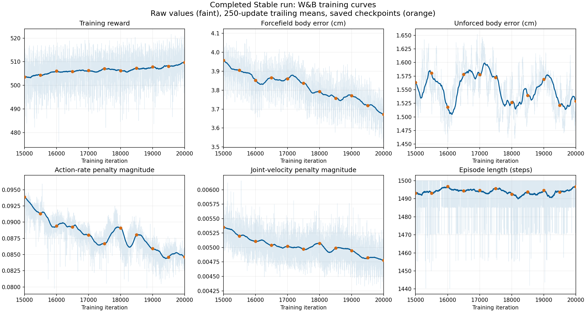

# Checkpoint selection: completed Stable run

This page records the original 15k–20k comparison. The broader
[wrist-noise review](WRIST_NOISE_REVIEW.md) now recommends the 24k candidate;
24k is now the installed demo and deployment default.

W&B: [https://wandb.ai/mht3/g1_compliance/runs/0e0cx7an](https://wandb.ai/mht3/g1_compliance/runs/0e0cx7an). Downloaded all 5,250 history rows from iterations 14,750–19,999; `_step` is the actual learning iteration. Checkpoints are saved every 500 iterations, plus the final 19,999 checkpoint.

**Historical selection: 15,000 for this 15k–20k comparison.** The later 24k selection supersedes it; see the linked review above.

## W&B evidence

Trailing 250-update averages from 15k to 19,999: reward 503.53 → 509.70 (+1.2%); forcefield body error 3.96 → 3.67 cm (−7.2%); action-rate penalty magnitude 0.0939 → 0.0846 (−9.9%). Episode length remains near the 1,500-step maximum. These training metrics average stochastic actions and many environments/joints. They are useful indicators of learning, but do not isolate wrist sensitivity during deterministic ONNX inference.

## Controlled simulation results

Each checkpoint had 16 basic 30-second tests: unforced standing, a 20 N outward pull on each hand separately, and 30 N downward on both hands; each tested clean and with noise seeds 42/43/44. Four-second loads use one-second cosine ramps, followed by recovery. All trials use the same reference, PD gains, 50 Hz actor, 5 ms physics, body friction 0.5 and foot friction 0.6. Passed means both survival and the recorded recovery limits were met. These are moderate loads, below the training cap.

| Checkpoint | Basic tests passed | Noisy wrist RMS (rad/s) | Wrist action-rate RMS |
|---|---:|---:|---:|
| 15,000 | 16/16 | 0.443 | 12.66 |
| 15,500 | 15/16 | 0.660 | 17.89 |
| 16,000 | 16/16 | 0.611 | 14.94 |
| 16,500 | 16/16 | 0.460 | 12.60 |
| 17,000 | 16/16 | 0.464 | 12.38 |
| 17,500 | 16/16 | 0.539 | 14.74 |
| 18,000 | 16/16 | 0.505 | 13.65 |
| 18,500 | 16/16 | 0.497 | 13.84 |
| 19,000 | 13/16 | 0.472 | 12.81 |
| 19,500 | 16/16 | 0.516 | 12.91 |
| 19,999 | 16/16 | 0.462 | 13.37 |

15.5k missed one downward-load recovery check; 19k missed three. Those were position-recovery failures, not falls. The other candidates passed all basic tests. The complete comparison also contains two delay stress tests and one training-contact test per checkpoint. Previously measured candidates were reused with the identical protocol and matching ONNX hashes.

## Fresh noise confirmation

Five additional seeds (100–104), 30 seconds each, unforced standing:

| Checkpoint | Mean wrist RMS (rad/s) | Across-seed standard deviation |
|---|---:|---:|
| 15,000 | 0.442 | 0.010 |
| 16,500 | 0.448 | 0.007 |
| 17,000 | 0.447 | 0.010 |
| 19,999 | 0.459 | 0.005 |

All 20 confirmation trials passed. 15k remains lowest, but its advantage over 16.5k and 17k is small; this does not establish a universal or statistically definitive hardware ranking. 17k has slightly lower wrist action-rate RMS in the original comparison, while 19,999 has better clean-sensor wrist motion and the strongest overall W&B trend. That comparison therefore retained 15k until the broader review.

The noise distribution is an uncalibrated training corruption model. No robot was commanded. Real sensor recordings and physical validation remain necessary.

Full data: [evaluation and W&B summary](../deploy/robots/g1_23dof/config/policy/compliant_mimic/stand/checkpoint_selection_15_20k.json). Reproduce using `scripts/select_standing_checkpoint.py` and `scripts/analyze_checkpoint_curves.py`; their `--help` options specify bundle/history inputs.
